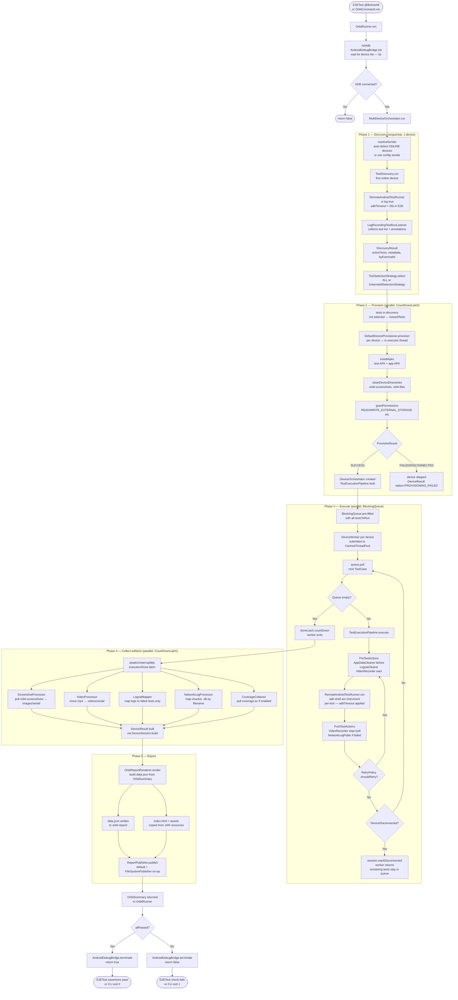

# Orbit — Contribution Guide

---

## Table of Contents

1. [OOD Class Diagram](#1-ood-class-diagram)
2. [E2E Execution Flowchart](#2-e2e-execution-flowchart)
3. [Understanding Orbit — Reading Guide](#3-understanding-orbit--reading-guide)

---

## 1. OOD Class Diagram

Key classes, their fields/methods, and relationships. Interfaces shown with dashed arrows (`..>`), composition with solid arrows (`-->`).

```mermaid
classDiagram
    direction TB

    %% ── Entry point ──────────────────────────────────────────────────────────
    class OrbitRunner {
        -RunConfig config
        +run() boolean
        -initAdb() AndroidDebugBridge
        -resolveAdbPath() String
        -allPassed(OrbitSummary) boolean
        -logSummary(OrbitSummary)
    }

    %% ── Configuration ────────────────────────────────────────────────────────
    class RunConfig {
        +File testApk
        +List~File~ otherApks
        +String appPackage
        +String testPackage
        +String testRunner
        +Set~String~ serials
        +Set~String~ skipSerials
        +Duration adbTimeout
        +boolean grantAll
        +boolean trackLogcat
        +boolean recordVideo
        +boolean trackNetworkLogs
        +boolean codeCoverage
        +RetryPolicy retryPolicy
        +TestSelectionStrategy selectionStrategy
        +File output
        +File androidSdk
        +effectiveTestPackage() String
        +logcatPriority(String)$ int
    }

    class ApkManifestReader {
        <<utility>>
        +readInstrumentation(File)$ InstrumentationInfo
        +fillMissing(RunConfig)$ RunConfig
    }

    %% ── Gradle plugin (orbit-gradle-plugin) ──────────────────────────────────
    class OrbitPlugin {
        +apply(Project)
        -createRunnerConfiguration() Configuration
        -registerPrebuiltTask() orbitTest
        +configureCommon(OrbitTestTask, OrbitExtension, GradleOverrides, Configuration)$
    }
    class OrbitExtension {
        <<orbit DSL>>
        +RegularFileProperty testApk
        +RegularFileProperty targetApk
        +Property~String~ executionMode
        +MapProperty instrumentationArgs
        +Property~Boolean~ ignoreFailures
        +Property~String~ runnerVersion
    }
    class GradleOverrides {
        +string(name) Provider
        +bool(name) Provider
        +list(name) Provider
        +map(name) Provider
        +regularFile(name) Provider
    }
    class AndroidVariantWiring {
        +register(Project, OrbitExtension, GradleOverrides, Configuration)
        -apkIn(Directory, BuiltArtifactsLoader) RegularFile
    }
    class OrbitTestTask {
        +RegularFileProperty testApk
        +RegularFileProperty targetApk
        +ConfigurableFileCollection runnerClasspath
        +runOrbit()
        -buildCliArgs() List~String~
    }
    class OrbitCommand {
        <<CLI main, own JVM>>
        +run()
    }

    %% ── Orchestration ────────────────────────────────────────────────────────
    class MultiDeviceOrchestrator {
        -RunConfig config
        -DeviceProvisioner provisioner
        -ExecutorService executor
        +run(AndroidDebugBridge) OrbitSummary
        -runDiscovery(Set, AndroidDebugBridge) DiscoveryResult
        -provisionAll(Set, AndroidDebugBridge) Map
        -buildPipeline() TestExecutionPipeline
        -resolveSerials(AndroidDebugBridge) Set
        -findOnlineDevice(AndroidDebugBridge, String) IDevice
        -awaitUninterruptibly(CountDownLatch)
    }

    class DeviceOrchestrator {
        -RunConfig config
        -TestExecutionPipeline pipeline
        -IDevice device
        -DeviceSession completedSession
        +getDevice() IDevice
        +startSession(IDevice) DeviceSession
        +execute(IDevice, TestCase, TestMetadata, DeviceSession)
        +endSession(IDevice, DeviceSession)
        +collectAndBuild(AndroidDebugBridge) DeviceResult
        -createRunner(IDevice, TestCase) RemoteAndroidTestRunner
        -buildCollectors(String, File) List
        -isDisconnect(Exception) boolean
    }

    class DeviceWorker {
        -IDevice device
        -BlockingQueue~TestCase~ queue
        -DeviceOrchestrator orchestrator
        -DiscoveryResult discovery
        -CountDownLatch doneLatch
        +run()
    }

    class DeviceSession {
        -String serial
        -MulticastTestRunListener multicast
        +addTestResult(TestCase, TestResult)
        +markDisconnected()
        +addException(String)
        +getMulticast() MulticastTestRunListener
        +build() DeviceResult
    }

    %% ── Discovery ────────────────────────────────────────────────────────────
    class TestDiscovery {
        -RunConfig config
        +run(IDevice) DiscoveryResult
        -createLogRunner(IDevice) RemoteAndroidTestRunner
        -buildDiscoveryResult(LogRecordingTestRunListener) DiscoveryResult
        -buildMetadata(TestCase, TestIdentifier, LogRecordingTestRunListener) TestMetadata
    }

    class LogRecordingTestRunListener {
        -List~TestIdentifier~ activeTests
        -List~TestIdentifier~ ignoredTests
        -Map annotations
        -boolean testRunFailed
        +activeTests() List
        +ignoredTests() List
        +annotationsFor(TestIdentifier) List
        +externalIdFor(TestIdentifier) String
        +clearAppDataActionFor(TestIdentifier) String
        +isTestRunFailed() Boolean
    }

    %% ── Execution ────────────────────────────────────────────────────────────
    class TestExecutionPipeline {
        -List~PreTestAction~ preActions
        -List~PostTestAction~ postActions
        -RetryPolicy retryPolicy
        +execute(IDevice, TestExecutionContext, RemoteAndroidTestRunner, Collection, RecentTestOutcomeProvider)
    }

    class TestExecutionContext {
        +TestCase testCase
        +TestMetadata metadata
        +String deviceSerial
        +String externalStorage
        +int attemptNumber
        +withAttemptNumber(int) TestExecutionContext
    }

    class AppDataCleaner {
        -String appPackage
        +before(IDevice, TestExecutionContext)
        +after(IDevice, TestExecutionContext, boolean)
    }

    class VideoRecorder {
        +before(IDevice, TestExecutionContext)
        +after(IDevice, TestExecutionContext, boolean)
        -stopAndWaitForCompletion(IDevice, TestExecutionContext)
        -isFileCompleted(IDevice, TestExecutionContext) boolean
        -deleteVideo(IDevice, TestExecutionContext)
    }

    class LogcatClearer {
        +before(IDevice, TestExecutionContext)
    }

    class NetworkLogPuller {
        -File outputDir
        +after(IDevice, TestExecutionContext, boolean)
    }

    %% ── Listeners ────────────────────────────────────────────────────────────
    class OrbitTestRunListener {
        -Map~TestIdentifier, TestResult.Builder~ inProgress
        -boolean recentTestFailed
        -TestResult lastResult
        -String runFailureMessage
        +testStarted(TestIdentifier)
        +testFailed(TestIdentifier, String)
        +testAssumptionFailure(TestIdentifier, String)
        +testIgnored(TestIdentifier)
        +testEnded(TestIdentifier, Map)
        +testRunFailed(String)
        +didRecentTestFail() boolean
        +getLastResult() TestResult
        +getRunFailureMessage() String
    }

    class MulticastTestRunListener {
        -List~ITestRunListener~ delegates
        +multiRunStarted(String, int)
        +multiRunEnded()
        +testStarted(TestIdentifier)
        +testFailed(TestIdentifier, String)
        +testEnded(TestIdentifier, Map)
        +testRunFailed(String)
    }

    %% ── Provisioning ─────────────────────────────────────────────────────────
    class DefaultDeviceProvisioner {
        -AndroidDebugBridge adb
        -DeviceConnectionChecker connectionChecker
        +provision(IDevice, RunConfig) ProvisionResult
        -installApks(IDevice, RunConfig) boolean
        -grantPermissions(IDevice, RunConfig) boolean
        -cleanDeviceDirectories(IDevice) boolean
        -resolveFailure(IDevice, RunConfig) ProvisionResult
    }

    class DeviceConnectionChecker {
        +isAvailable(AndroidDebugBridge, String) boolean
    }

    %% ── Domain ───────────────────────────────────────────────────────────────
    class DiscoveryResult {
        +List~TestCase~ activeTests
        +List~TestCase~ ignoredTests
        +Map~TestCase, TestMetadata~ metadata
        +Map~String, TestCase~ byExternalId
    }

    class TestCase {
        +String className
        +String methodName
        +displayName() String
        +from(TestIdentifier) TestCase
    }

    class TestMetadata {
        +TestCase testCase
        +boolean clearAppDataBefore
        +boolean clearAppDataAfter
        +boolean clearLogcatBefore
        +String externalId
    }

    class TestResult {
        +TestCase testCase
        +TestStatus status
        +long startedAt
        +long durationMs
        +List~File~ screenshots
        +List~File~ videos
        +String externalId
        +isFailed() boolean
        +isPassed() boolean
    }

    class DeviceResult {
        +String serial
        +DeviceStatus status
        +long startedAt
        +long durationMs
        +Map~TestCase, TestResult~ testResults
        +List exceptions
    }

    class OrbitSummary {
        +String title
        +long startedAt
        +long durationMs
        +Map~String, DeviceResult~ results
        +List~TestCase~ missedTests
        +String orbitVersion
    }

    %% ── Interfaces ───────────────────────────────────────────────────────────
    class PreTestAction {
        <<interface>>
        +before(IDevice, TestExecutionContext)
    }

    class PostTestAction {
        <<interface>>
        +after(IDevice, TestExecutionContext, boolean)
    }

    class DeviceProvisioner {
        <<interface>>
        +provision(IDevice, RunConfig) ProvisionResult
    }

    class RetryPolicy {
        <<interface>>
        +shouldRetry(TestExecutionContext, TestResult) boolean
        NONE
    }

    class TestSelectionStrategy {
        <<interface>>
        +select(DiscoveryResult) List~TestCase~
        ALL
    }

    class RecentTestOutcomeProvider {
        <<interface>>
        +didRecentTestFail() boolean
        +getLastResult() TestResult
    }

    %% ── Relationships ────────────────────────────────────────────────────────
    OrbitRunner --> RunConfig
    OrbitRunner --> MultiDeviceOrchestrator : creates

    MultiDeviceOrchestrator --> RunConfig
    MultiDeviceOrchestrator --> DeviceProvisioner
    MultiDeviceOrchestrator --> TestDiscovery : creates
    MultiDeviceOrchestrator --> DeviceOrchestrator : creates
    MultiDeviceOrchestrator --> DeviceWorker : submits to executor
    MultiDeviceOrchestrator --> OrbitSummary : builds

    DeviceWorker --> DeviceOrchestrator : delegates
    DeviceWorker --> DiscoveryResult : reads metadata
    DeviceWorker --> DeviceSession : manages

    DeviceOrchestrator --> RunConfig
    DeviceOrchestrator --> TestExecutionPipeline
    DeviceOrchestrator --> DeviceSession : creates
    DeviceOrchestrator --> OrbitTestRunListener : creates per test
    DeviceOrchestrator --> DeviceResult : builds via session

    DeviceSession --> MulticastTestRunListener
    DeviceSession --> DeviceResult : builds

    TestDiscovery --> RunConfig
    TestDiscovery --> LogRecordingTestRunListener : creates
    TestDiscovery --> DiscoveryResult : returns

    TestExecutionPipeline --> RetryPolicy
    TestExecutionPipeline --> PreTestAction : calls before
    TestExecutionPipeline --> PostTestAction : calls after

    AppDataCleaner ..|> PreTestAction
    AppDataCleaner ..|> PostTestAction
    VideoRecorder ..|> PreTestAction
    VideoRecorder ..|> PostTestAction
    LogcatClearer ..|> PreTestAction
    NetworkLogPuller ..|> PostTestAction

    DefaultDeviceProvisioner ..|> DeviceProvisioner
    DefaultDeviceProvisioner --> DeviceConnectionChecker

    OrbitTestRunListener ..|> RecentTestOutcomeProvider
    MulticastTestRunListener --> OrbitTestRunListener : delegates to

    DiscoveryResult --> TestCase
    DiscoveryResult --> TestMetadata
    DeviceResult --> TestResult
    OrbitSummary --> DeviceResult
    TestResult --> TestCase
    TestMetadata --> TestCase

    RunConfig --> RetryPolicy
    RunConfig --> TestSelectionStrategy
    OrbitRunner --> ApkManifestReader : fillMissing()

    OrbitPlugin --> OrbitExtension : creates
    OrbitPlugin --> OrbitTestTask : registers orbitTest
    OrbitPlugin --> AndroidVariantWiring : with com.android.application
    AndroidVariantWiring --> OrbitTestTask : registers orbitVariantAndroidTest
    OrbitTestTask --> GradleOverrides : -Porbit overrides the orbit DSL
    OrbitTestTask --> OrbitCommand : javaexec CLI args, exit code
    OrbitCommand --> RunConfig : builds
    OrbitCommand --> OrbitRunner : run()
```



---

## 2. E2E Execution Flowchart

End-to-end flow from `./gradlew :orbit-runner:e2eTest` (or CLI) through all 5 phases to report output.



---

## 3. Understanding Orbit — Reading Guide

Read in this order — each step builds on the last.

### Step 1 — Config contract (`RunConfig.java`)
Everything Orbit can do is expressed as a field here. Read it top to bottom once. You'll have a mental map of every feature before reading any logic.

### Step 2 — Entry point (`OrbitRunner.java`)
Seven methods, under 150 lines. Shows ADB lifecycle and delegates all work to `MultiDeviceOrchestrator`. Nothing surprising.

### Step 3 — The 5-phase mental model (`MultiDeviceOrchestrator.java`)
The `run()` method is the skeleton of the whole system:
```
Phase 1  resolveSerials → runDiscovery
Phase 2  provisionAll   (parallel CountDownLatch)
Phase 3  DeviceWorkers  (parallel BlockingQueue)
Phase 4  collectAndBuild (parallel CountDownLatch)
Phase 5  report
```
Understand this and you understand the system. Every other class is an implementation detail of one phase.

### Step 4 — Concurrency model (`DeviceWorker.java`)
`queue.poll()` with no timeout. Workers drain the shared queue and exit when it's empty. Device disconnect → worker exits, remaining tests stay in queue for other workers.

### Step 5 — Test discovery (`TestDiscovery.java` + `LogRecordingTestRunListener.kt`)
Phase 1 is just `adb shell am instrument -e log true`. The listener records what the runner reports without executing anything. Result: typed `DiscoveryResult` with metadata per test.

### Step 6 — Per-test execution (`TestExecutionPipeline.java`)
Pre-actions → `runner.run()` → post-actions → retry check. The retry loop is the only non-trivial control flow. Actions and retry policy are all pluggable.

### Step 7 — Extension points (Section 5 in orbit-design.md)
`PreTestAction`, `PostTestAction`, `ArtifactCollector`, `RetryPolicy`, `TestSelectionStrategy`, `ReportPublisher`. Adding a feature = implementing one interface, wiring it in `RunConfig` or `buildPipeline()`. No existing class needs to change.

### Key invariants to keep in mind
- `RunConfig` is immutable — built once at entry, passed everywhere by reference
- `DeviceSession` is the only mutable state per device — lives Phase 2 → Phase 4
- `adbTimeout` must be applied to every `RemoteAndroidTestRunner` via `setMaxTimeToOutputResponse()` — see `TestDiscovery.createLogRunner()` and `DeviceOrchestrator.createRunner()`
- `queue.poll()` (no timeout) — workers exit immediately when the queue is empty; do not add a timeout here