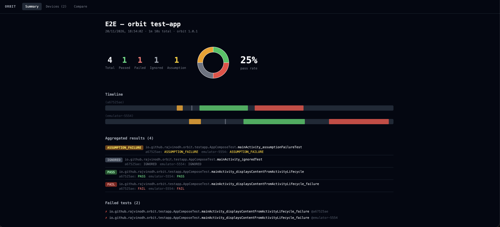
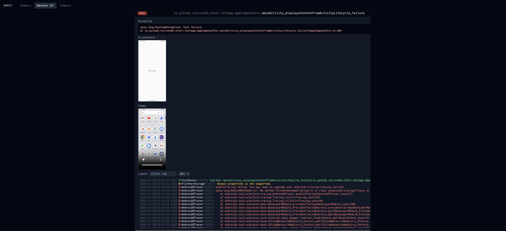
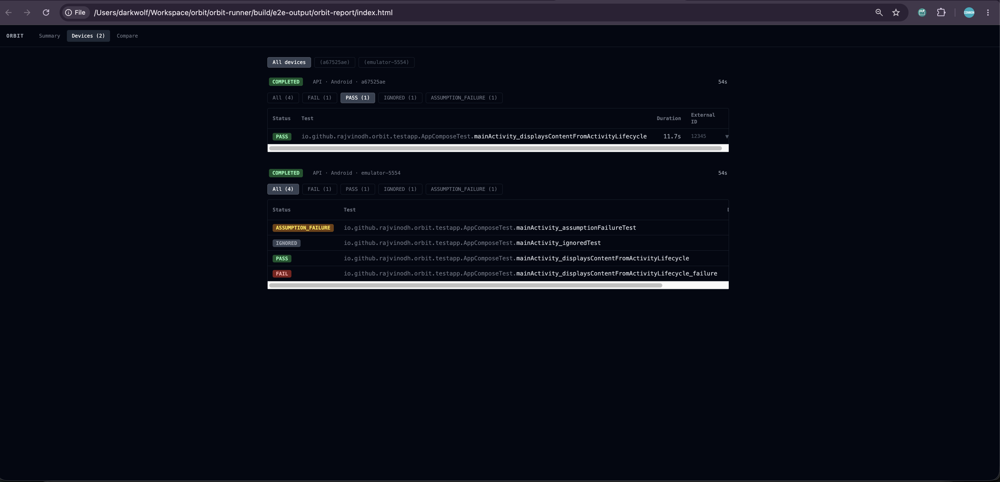

# Orbit

Orbit runs your Android instrumentation tests on every connected device and emulator at the same
time, then gives you one HTML report covering all of them.

- **DISTRIBUTE** (default): the tests are split across devices, so the suite finishes faster.
- **FANOUT**: every test runs on every device, so you can compare them.

For each test the report can show screenshots, logcat, a screen recording, network logs
(Chucker), files saved by the test, and code coverage.








---

## 1. Add the client to your tests

Both the CLI and the Gradle plugin need the client in your **androidTest** dependencies. Orbit
uses it to read test annotations when it discovers tests, and to save screenshots and files
during a test.

```kotlin
dependencies {
    androidTestImplementation("io.github.rajvinodh:orbit-client-android:1.0.1")
}
```

Add `OrbitRule` to your test classes:

```kotlin
class LoginTest {
    @get:Rule
    val orbit = OrbitRule(InstrumentationRegistry.getInstrumentation())

    @Test
    @ExternalId("C1234")                // test-case ID from TestRail, Jira, etc. Used by --external-ids
    @ClearAppData(before = true)        // run `pm clear` before this test
    @ClearLogcat                        // clear logcat before this test
    fun validLogin() {
        // ...
        Orbit.screenshot("after_login")                  // shows up in the report
        Orbit.addFile("response.json", responseFile)     // attached to this test in the report
    }
}
```

| API | What it does |
|---|---|
| `OrbitRule` | Required for `Orbit.screenshot` / `Orbit.addFile` |
| `Orbit.screenshot(tag)` | Takes a full-screen screenshot and attaches it to the test |
| `Orbit.addFile(name, file)` | Attaches any file to the test |
| `@ExternalId("…")` | Tags the test with an external ID |
| `@ClearAppData(before, after)` | Clears app data before and/or after the test |
| `@ClearLogcat` | Clears the logcat buffer before the test |

---

## 2. Run from the CLI

Build the CLI jar:

```bash
git clone https://github.com/rajvinodh/orbit.git && cd orbit
(cd orbit-report && npm ci)           # the report UI is bundled into the jar
./gradlew :orbit-runner:shadowJar     # → orbit-runner/build/libs/orbit-runner-1.0.1.jar
```

Run it:

```bash
java -jar orbit-runner-1.0.1.jar <TEST_APK> <APP_APK> [OTHER_APKS...] [options]
```

```bash
# Every connected device, default settings
java -jar orbit-runner-1.0.1.jar app-debug-androidTest.apk app-debug.apk

# One class on two specific devices, every test on both
java -jar orbit-runner-1.0.1.jar app-debug-androidTest.apk app-debug.apk \
  --class-name com.myapp.LoginTest \
  --serial emulator-5554 --serial emulator-5556 \
  --execution-mode FANOUT

# Grant permissions, capture logcat and video, run only @Smoke tests
java -jar orbit-runner-1.0.1.jar app-debug-androidTest.apk app-debug.apk \
  --grant-all --logcat --video -e annotation com.myapp.Smoke
```

The report is written to `orbit-output/orbit-report/index.html`.
Exit code: `0` all tests passed, `1` some tests failed, anything else is an error.

### CLI options

| Option | Default | Description |
|---|---|---|
| `TEST_APK` | (required) | The androidTest APK |
| `OTHER_APKS...` | | The app APK first, then any extra APKs to install |
| `-p`, `--app-package` | read from the test APK | Package of the app under test |
| `--test-package` | read from the test APK | Package of the test APK |
| `--test-runner` | read from the test APK | Instrumentation runner class |
| `--serial` | all connected devices | Run only on this device. Repeat it for more than one |
| `--skip-serial` | | Leave out this device. Can be repeated |
| `--allow-no-devices` | off | Don't fail when no device is connected |
| `--adb-timeout` | `PT10M` | Timeout for each ADB command (ISO-8601 duration) |
| `--availability-timeout` | `30` | How many minutes to wait for a free device |
| `--class-name` | | Run only this class (fully qualified name) |
| `--method-name` | | Run only this method. Needs `--class-name` |
| `-e KEY VALUE` | | Instrumentation argument. Can be repeated |
| `--external-ids` | | Run only tests with these `@ExternalId`s: `C1,C2` or `@ids.txt` |
| `--execution-mode` | `DISTRIBUTE` | `DISTRIBUTE` (split tests across devices) or `FANOUT` (every test on every device) |
| `--grant-all` | off | Grant all runtime permissions when installing |
| `--clear-app-data` | off | Run `pm clear` before every test |
| `--coverage` | off | Collect coverage from each device and merge it into `coverage/merged-coverage.ec` |
| `--logcat` | off | Capture logcat. It's attached to failed tests |
| `--logcat-level` | `I` | Lowest logcat level to keep: `V` `D` `I` `W` `E` |
| `--video` | off | Record the screen for each test |
| `--network-logs` | off | Capture the Chucker database for each failed test |
| `-o`, `--output` | `orbit-output` | Output directory |
| `--sdk` | `$ANDROID_HOME` | Android SDK path |
| `--title` | `<package> · <date>` | Report title |
| `--appium-settings-version` | `7.0.24` | Version of `io.appium.settings` installed on the devices |
| `--no-appium-settings` | off | Don't install `io.appium.settings` |
| `--debug` | off | Verbose logging |
| `--always-zero` | off | Always exit with `0`, even when tests fail |

---

## 3. Run from Gradle

If you'd rather not build or run a jar, use the Gradle plugin. It downloads the runner itself, and it can build the
APKs for you.

### Add the plugin

`settings.gradle.kts`

```kotlin
pluginManagement {
    repositories {
        google()
        mavenCentral()
        gradlePluginPortal()
    }
}
dependencyResolutionManagement {
    repositories {
        google()
        mavenCentral()       // the plugin downloads orbit-runner from here
    }
}
```

`app/build.gradle.kts`

```kotlin
plugins {
    id("com.android.application")
    id("io.github.rajvinodh.orbit") version "1.0.1"
}

apply(from = "orbit.gradle")      // your Orbit config, next to this file

dependencies {
    androidTestImplementation("io.github.rajvinodh:orbit-client-android:1.0.1")
}
```

### Configure it in `orbit.gradle`

Keep your team's fixed settings in `app/orbit.gradle`:

```groovy
orbit {
    executionMode = "DISTRIBUTE"         // or "FANOUT"
    grantAll = true
    trackLogcat = true
    logcatLevel = "I"
    recordVideo = true
    trackNetworkLogs = false
    coverage = false
    availabilityTimeoutMin = 30L
    ignoreFailures = false               // true: failing tests don't fail the build

    devices = ["emulator-5554", "emulator-5556"]     // leave out to use every device
    instrumentationArgs = [listener: "com.myapp.MyRunListener"]
    title = "MyApp UI tests"

    // Groovy logic works too. For example, `-PTestGroup=Smoke` runs only @Smoke tests:
    if (project.hasProperty("TestGroup")) {
        instrumentationArgs.put("annotation", "com.myapp.annotations." + project.TestGroup)
        title = project.TestGroup
    }
}
```

A working example is in [`test-app/composeApp/orbit.gradle`](test-app/composeApp/orbit.gradle).

### Tasks

| Task | What it does |
|---|---|
| `orbit<Variant>AndroidTest`, e.g. `orbitDebugAndroidTest` | Builds the app and test APKs for that variant, then runs them. Unchanged APKs aren't rebuilt |
| `orbitTest` | Runs APKs that are already built. Compiles nothing |

```bash
./gradlew :app:orbitDebugAndroidTest
./gradlew :app:orbitDebugAndroidTest -Porbit.className=com.myapp.LoginTest -Porbit.methodName=validLogin
./gradlew :app:orbitDebugAndroidTest -Porbit.devices=emulator-5554,emulator-5556 -Porbit.executionMode=FANOUT
./gradlew :app:orbitTest -Porbit.testApk=path/app-debug-androidTest.apk -Porbit.targetApk=path/app-debug.apk
```

The report goes to `app/build/orbit-output/orbit-report/index.html`, and the task prints a
link to it.

### Options

You can set any option in `orbit { }`, and override it for one run with `-Porbit.<name>=<value>`.
The `-P` value wins, except for `instrumentationArgs`: the `-P` pairs are **added to** the ones in
`orbit { }`.

| Name | Type | `-P` format / notes |
|---|---|---|
| `testApk`, `targetApk` | file | Only for `orbitTest`. A relative path is resolved from the root project |
| `otherApks` | files | Extra APKs to install. Only in `orbit { }` |
| `appPackage`, `testPackage`, `testRunner` | string | Only for `orbitTest`. Read from the test APK if not set |
| `devices`, `skipDevices` | list | Comma-separated serials |
| `allowNoDevices` | boolean | |
| `adbTimeout` | string | ISO-8601, e.g. `PT10M` |
| `availabilityTimeoutMin` | long | Minutes |
| `className`, `methodName` | string | `methodName` needs `className` |
| `instrumentationArgs` | map | `k=v,k2=v2` |
| `externalIds` | string | `C1,C2` or `@path/ids.txt` |
| `executionMode` | string | `DISTRIBUTE` / `FANOUT` |
| `grantAll`, `clearAppData`, `coverage` | boolean | |
| `trackLogcat`, `recordVideo`, `trackNetworkLogs` | boolean | |
| `logcatLevel` | string | `V` `D` `I` `W` `E` |
| `outputDir` | dir | Default: `build/orbit-output` |
| `title` | string | Report title |
| `appiumSettingsVersion`, `noAppiumSettings` | string / boolean | |
| `debug` | boolean | Verbose logging |
| `ignoreFailures` | boolean | Default `false` |
| `runnerVersion` | string | orbit-runner version. Default: same as the plugin |
| `sdkDir` | dir | Default: the SDK AGP uses, else `ANDROID_HOME` |
| `workerMaxHeap` | string | Heap size for the runner's JVM. Default `1g`. Only in `orbit { }` |

---

## License

[Apache 2.0](LICENSE). To contribute, see [CONTRIBUTION_GUIDE.md](CONTRIBUTION_GUIDE.md).
